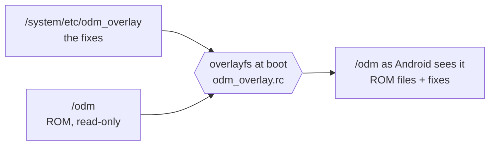
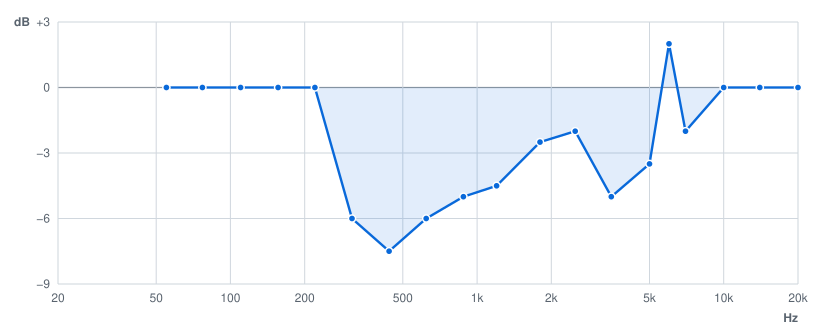

<div align="center">

# OnePlus 8 · crDroid QoL

Fixes and tuning for the **OnePlus 8** (`instantnoodle`) on **crDroid 16** (Android 16).<br>
No root, no Magisk: everything rides on a read-only overlay and can be undone in one step.

[](https://github.com/the-platapus/oneplus8-crdroid-qol/actions/workflows/flashable.yml)
[](https://github.com/the-platapus/oneplus8-crdroid-qol/releases/latest)
[](LICENSE)

</div>

## What you get

| | Fix | What changes |
|---|---|---|
| 🔊 | **Dolby** | The ROM's Dolby service links against `libstagefright_foundation-v33.so` but the ROM doesn't ship it, so the service crash-loops and the Dolby app crashes. The library is added. |
| 🎚️ | **JamesDSP** | The JamesDSP effect is wired into `/odm/etc/audio_effects.xml`, and the root build of the JamesDSP app is installed. The phone speaker gets a curve tuned by ear against an iPhone 13 ([below](#the-speaker-curve)). |
| 🌡️ | **Thermals** | Skin-temperature throttling kicks in 4 °C lower, so the phone stays cooler in the hand. `skin-therm` trips are 42/43/44/46 °C (stock 46/47/48/50); `skin-msm-therm-step` trips are 59/61 °C (stock 63/65). |
| 📳 | **Haptics** | A replacement vibrator HAL with strength control and haptic primitives. Sliders and notification swipes give one soft tick per step instead of a full-power buzz, and fast typing no longer drops clicks ([details](#haptics)). |

Tested on an IN2015 running crDroid `v12.9-20260424` (build `BP4A.251205.006`).

## Install

### Flashable zip (recommended)

1. Download `oneplus8-fixes-<version>.zip` from the [latest release](https://github.com/the-platapus/oneplus8-crdroid-qol/releases/latest). The release notes list its SHA-256.
2. Boot to recovery and tap **Apply update › Apply from ADB**.
3. Run `adb sideload oneplus8-fixes-<version>.zip` on the PC. Recovery says the signature can't be verified: tap **Yes**.
4. Reboot.

The zip checks the ROM and installs only what still applies. It builds and test-mounts everything in recovery's RAM before touching `/system`. A no-write dry run and more detail are in [`flashable/README.md`](flashable/README.md).

### From a PC with `apply.sh`

Needs `bash`, `adb` and `python3`.

```bash
./apply.sh recovery   # in recovery, after "Mount system" + "Enable ADB"
./apply.sh postboot   # booted: JamesDSP app + speaker preset, slider haptics
./apply.sh status     # booted: what's active
./apply.sh remove     # in recovery: undo
```

### After a ROM update

The overlay lives in `/system`, so a ROM update removes it. Flash the zip (or run `./apply.sh recovery`) again right after the ROM. If recovery asks you to reboot to recovery first, do that: it moves recovery to the new slot. The JamesDSP app, its settings and your slider haptics live in `/data` and survive. Only after a **clean** flash do you also run `./apply.sh postboot`.

## How it works



`/odm` is read-only, so the files live in `/system/etc/odm_overlay`. An init script overlays them onto `/odm` at every boot with `override_creds=off`, so SELinux sees exactly what it would without the overlay. Each file carries the SELinux label of the real file it stands in for.

Nothing runs as root. The thermal script runs once at boot in `thermal-engine`'s domain. The vibrator HAL replaces the ROM's service under the same name and user. If it ever crashes, init falls back to the ROM's HAL by itself.

## The speaker curve

<p align="center"></p>

| Hz | 55–220 | 311 | 440 | 622 | 880 | 1200 | 1800 | 2500 | 3500 | 5000 | 6000 | 7000 | 10k–20k |
|---|---|---|---|---|---|---|---|---|---|---|---|---|---|
| dB | 0 | −6 | −7.5 | −6 | −5 | −4.5 | −2.5 | −2 | −5 | −3.5 | **+2** | −2 | 0 |

Graphic EQ on, output gain −0.29 dB, limiter at −0.1 dB with 60 ms release, everything else off. The preset is [`files/jamesdsp/Oneplus_8_speakers.tar`](files/jamesdsp/Oneplus_8_speakers.tar). Every stored value is in [`JAMESDSP.md`](JAMESDSP.md), and the chart is drawn from the preset itself by [`docs/eq-curve.py`](docs/eq-curve.py).

**Speaker only.** In JamesDSP, open Settings › Device profiles and turn on **Per-device profiles**. Then, with nothing plugged in or connected, load the preset (Presets › Import). Headphones and Bluetooth devices keep their own profiles. Without root an app's settings can't be set from outside, so `./apply.sh postboot` copies the preset to `Download/` and lists these taps.

## Haptics

The ROM's vibrator HAL couldn't play reduced strength, so Android 16's gentle SystemUI textures played at full power. The replacement HAL ([`haptics-hal/`](haptics-hal)) adds:

- **Strength control:** soft effects play soft, through the aw8697 driver's live gain.
- **Haptic primitives:** click, tick, low tick and thud, played from the chip's own waveforms, so SystemUI uses the ticks it was designed around.
- **One tick per step:** bursts of identical ticks are played once.
- **Real effect lengths:** 20 ms instead of 150 ms, so fast typing keeps up.

The keyboard click and the effects Gboard uses are unchanged. The HAL is idle with no CPU use and about 5 MB of memory.

Strengths can be tuned live from adb, with no reflash:

| Property | Format | Default |
|---|---|---|
| `debug.vib.lowtick` | `wf,level,gmin,gmax,gamma` | `2,1400,20,42,1.0` |
| `debug.vib.tick` | same | `1,1400,24,100,1.0` |
| `debug.vib.click` / `debug.vib.thud` | same | `1,2500,48,128,1.0` / `4,2500,48,128,1.0` |
| `debug.vib.amp` | `gmax,gamma,short_ms` | `117,1.0,20` |
| `debug.vib.log` | `1` logs to `logcat -s vibrator-op8` | `0` |

To go back to the ROM's HAL: `adb shell setprop persist.debug.vib.stock 1`, then reboot. The full story, with every change and its undo, is in [`HAPTICS-LOG.md`](HAPTICS-LOG.md).

## Safety and undo

- Each fix checks the ROM first and skips itself if the ROM changed (Dolby library shipped, 64-bit audio HAL, different vibrator stack).
- Both installers test-mount the overlay before you reboot, and leave nothing behind if that fails.
- **Undo everything:** flash `oneplus8-fixes-uninstall-<version>.zip`, or run `./apply.sh remove` in recovery.

## Releases

CI ([`.github/workflows/flashable.yml`](.github/workflows/flashable.yml)) builds both zips on every push and pull request. It tests them against a fake recovery under mksh (Android's shell), dash and busybox sh, and keeps them as a build artifact. Pushing a tag `v<YYYYMMDD>` publishes them as a GitHub Release with checksums:

```bash
git tag v20261114 && git push origin v20261114
```

Builds are reproducible: the same commit always gives byte-identical zips.

## Layout

```
apply.sh                 install / postboot / status / remove over adb
files/                   everything that gets installed, checksummed in SHA256SUMS
  jamesdsp/              the speaker preset
flashable/               recovery zip: installer, build.sh, test.sh (fake recovery)
haptics-hal/             vibrator HAL source and build.sh (NDK + AIDL)
docs/                    EQ chart and the script that draws it
JAMESDSP.md              every value in the speaker preset
HAPTICS-LOG.md           haptics findings and change log
```

## Credits and licenses

The scripts, HAL source and docs are [MIT](LICENSE). Bundled third-party parts keep their own licenses:

- **JamesDSP**: the root build of the app (`files/JamesDSP-v1.6.14-root.apk`, from [timschneeb/RootlessJamesDSP](https://github.com/timschneeb/RootlessJamesDSP)) and the effect library (`files/libjamesdsp.so`, from [james34602/JamesDSPManager](https://github.com/james34602/JamesDSPManager)). GPL-3.0, unmodified.
- **AOSP**: the vibrator AIDL files and binder NDK headers in `haptics-hal/third_party/`, and `libstagefright_foundation-v33.so`. Apache-2.0, © The Android Open Source Project.

Not affiliated with OnePlus, crDroid or LineageOS. Flashing anything carries risk; keep a backup.
